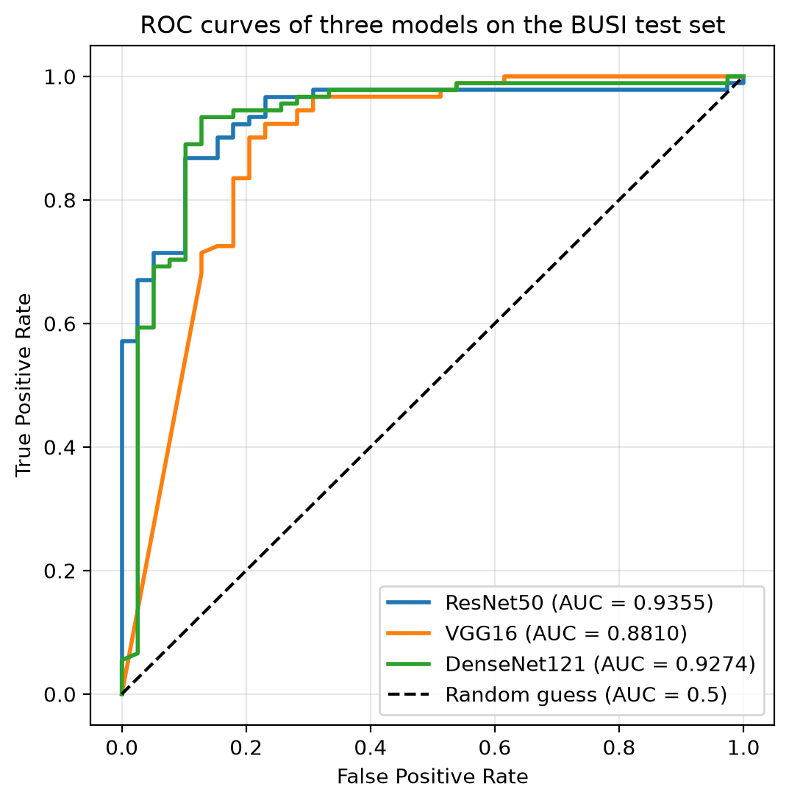

# Comparison of ResNet50, VGG16, and DenseNet121 for BUSI Classification

## Introduction

This experiment compares three convolutional neural networks for classifying breast ultrasound images from the cleaned BUSI dataset as **malignant (0)** or **benign (1)**. The aim is to compare classification performance at the default decision threshold and discrimination across thresholds. This summary follows [ROC_comparison.ipynb](notebooks/ROC_comparison.ipynb), with training details and classification metrics checked against the accompanying training scripts and saved test predictions.

- **ResNet50** is a 50-layer network that uses residual connections to help gradients flow through deep layers and make optimization easier.
- **VGG16** is a 16-layer network built from stacked small convolutional filters and fully connected classification layers. It provides a comparatively simple architectural baseline.
- **DenseNet121** is a 121-layer network with dense connections that pass features from earlier layers to later layers within each dense block, encouraging feature reuse and gradient flow.

All three models start from ImageNet-pretrained weights and replace their final classification layer with a linear layer producing two outputs. All model parameters are fine-tuned for the BUSI task.

## Experimental Settings

| Setting | Configuration |
| --- | --- |
| Dataset and task | Cleaned BUSI dataset; binary malignant/benign image classification; normal images are excluded |
| Training set | 517 images: 171 malignant and 346 benign |
| Test set | 130 images: 39 malignant and 91 benign; identical images and labels for all models |
| Preprocessing | Convert to RGB, resize to 224 × 224, and convert to tensors |
| Normalization | ImageNet mean [0.485, 0.456, 0.406] and standard deviation [0.229, 0.224, 0.225] |
| Data augmentation | None in the training scripts |
| Training | 30 epochs; batch size 16; Adam optimizer; learning rate 0.0001; cross-entropy loss |
| Random seed | PyTorch seed 42; one training run per model |
| Checkpoint | Final weights saved after 30 epochs |
| ROC evaluation | Load saved weights, use evaluation mode and batches of 16, and compute softmax probabilities; the recorded notebook run uses CPU |

The comparison notebook performs inference only; it does not retrain the models. Predictions from the loaded models agree with the saved prediction files for all 130 test images for every model (agreement = 1.0000).

Accuracy measures the fraction of correctly classified images. Recall, precision, and F1 score are **macro averages**, calculated separately for each class and then averaged with equal weight. These metrics use the predicted class with the largest output score, equivalent to a 0.5 softmax decision boundary in this binary task. ROC curves plot true positive rate against false positive rate as the threshold varies, and AUC summarizes discrimination across thresholds. Following the notebook, **benign is the positive class for ROC/AUC**; ROC true positive rate therefore represents benign recall, whereas the table reports macro recall.

## Numeric Results

All values are on a 0–1 scale and rounded to four decimal places. Accuracy, recall, precision, and F1 score were verified from the saved test predictions in `outputs/`; AUC values come from the recorded output of the ROC comparison notebook. Bold values indicate the best result in each column.

| Model | Accuracy | Recall (macro) | Precision (macro) | F1 Score (macro) | AUC |
| --- | ---: | ---: | ---: | ---: | ---: |
| ResNet50 | 0.8923 | 0.8718 | 0.8718 | 0.8718 | **0.9355** |
| VGG16 | 0.8692 | 0.8260 | 0.8545 | 0.8381 | 0.8810 |
| DenseNet121 | **0.9154** | **0.9029** | **0.8972** | **0.9000** | 0.9274 |

## Findings

1. **DenseNet121 performs best at the default decision threshold.** It correctly classifies 119 of 130 images, compared with 116 for ResNet50 and 113 for VGG16. Its accuracy exceeds ResNet50 by 2.31 percentage points, and its macro F1 score is higher by 0.0282.
2. **ResNet50 achieves the highest AUC.** The AUC ranking is ResNet50 (0.9355), DenseNet121 (0.9274), and VGG16 (0.8810). ResNet50 exceeds DenseNet121 by approximately 0.0080, indicating a small advantage in overall discrimination across thresholds on this test set.
3. **The different rankings reflect different evaluation criteria.** Accuracy and macro F1 describe predictions at one decision boundary; AUC evaluates probability rankings across thresholds. DenseNet121 can therefore have better default-threshold predictions while ResNet50 has the higher AUC.
4. **Class imbalance makes class-specific errors important.** Benign images account for 70% of the test set. DenseNet121 correctly identifies 34 of 39 malignant images (recall 0.8718), compared with 32 for ResNet50 (0.8205) and 28 for VGG16 (0.7179). The respective numbers of malignant images classified as benign are 5, 7, and 11. Macro averages give both classes equal weight and complement overall accuracy.
5. **VGG16 has the lowest result on every reported metric.** Under the shared experimental settings, both ResNet50 and DenseNet121 outperform this baseline. The results alone do not establish which architectural property causes the difference.

## Conclusion

DenseNet121 gives the strongest classification results at the default threshold, achieving 0.9154 accuracy and 0.9000 macro F1. ResNet50 gives the highest AUC (0.9355), with DenseNet121 close behind (0.9274). Both are stronger candidates than VGG16 in this experiment; the preferred model depends on whether the priority is performance at the current decision threshold or discrimination across thresholds.

These findings are limited to a single fixed split with 130 test images and one training run per model. No confidence intervals or significance tests are reported, so the small AUC difference does not establish a definitive advantage for ResNet50. The scripts also monitor test performance each epoch without a separate validation set. Further comparison should use a validation set for model and threshold selection, repeated training with different seeds, and an independent test set to assess how reliably the results generalize.
